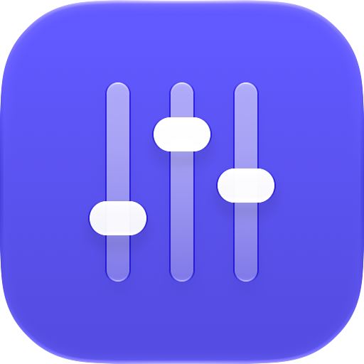
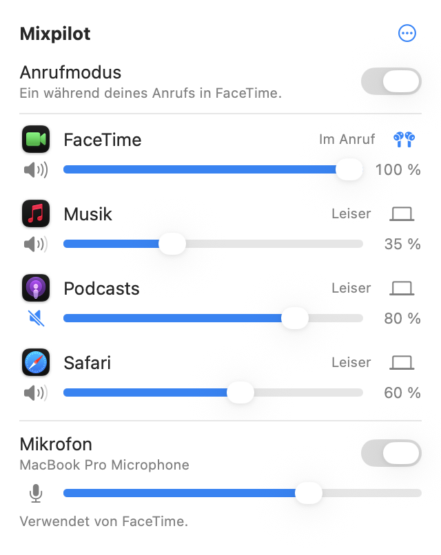

<p align="center">
  
</p>

<h1 align="center">Mixpilot</h1>

<p align="center">
  Die Lautstärke jeder App auf deinem Mac, einzeln, und Anrufe haben Vorrang.<br>
  Kostenlos · macOS 14.4 oder neuer · Deutsch und Englisch
</p>

<p align="center">
  <a href="https://mixpilot.blitzraum.com/de"><b>Website und Download</b></a> ·
  <a href="README.md">English</a>
</p>

<p align="center">
  
</p>

## Was Mixpilot kann

- **Lautstärke für jede App.** Mach jede App über die Menüleiste leiser oder schalte ihren Ton aus –
  wie der Lautstärkemixer unter Windows, aber so gebaut, wie Apple Mac-Apps baut.
- **Jede Ausgabe für jede App.** Schick einen Anruf an deine AirPods, während die Musik weiter über
  die Lautsprecher läuft. Wird ein Gerät getrennt, folgt die App dem System – und wechselt zurück,
  sobald es wieder verbunden ist.
- **Anrufe haben Vorrang.** Sobald WhatsApp, FaceTime, Zoom, Teams, Webex, Discord oder ein
  Browser-Tab das Mikrofon verwendet, werden alle anderen Apps sanft auf eine Lautstärke deiner Wahl
  leiser und nach dem Anruf wieder lauter. Deine eigenen Einstellungen bleiben unverändert.
- **Dein Mikrofon auf einen Blick.** Sieh, welche Apps es verwenden, stell die Eingangslautstärke ein
  und schalte es für alle Apps auf einmal aus. Die Menüleiste zeigt, wenn es aus ist.
- **Merkt sich jede App.** Deine Einstellungen gelten wieder, sobald eine App das nächste Mal Ton
  wiedergibt.
- **Tastaturkurzbefehle** für das Mikrofon, den Anrufmodus und die App im Vordergrund.
- **Nie lauter als die App selbst.** Mixpilot macht Apps nur leiser – zum Schutz deines Gehörs und
  deiner Lautsprecher.

## Installation

Lade das Disk-Image von [mixpilot.blitzraum.com](https://mixpilot.blitzraum.com/de), öffne es und
zieh Mixpilot in den Ordner „Programme“. Die App ist mit einer Developer ID signiert und von Apple
beglaubigt.

Beim ersten Start fragt Mixpilot nach der **Systemaudioaufnahme**: Um die Lautstärke einer App zu
ändern, braucht Mixpilot den Ton, den sie wiedergibt. Der Ton wird auf deinem Mac verarbeitet und
weder gespeichert noch gesendet.

## Datenschutz und Sicherheit

- Keine Accounts, keine Analysen, kein Netzwerkzugriff.
- Wird Mixpilot beendet oder stürzt ab, spielen alle Apps wieder normal: Die Umleitung ist so gebaut,
  dass ein Fehler nie eine App stumm lässt, und ein ausgeschaltetes Mikrofon wird wieder eingeschaltet.
- Einstellungen bleiben auf deinem Mac.

## Aus dem Quellcode bauen

Voraussetzungen: Xcode 27, zum Ausführen macOS 14.4 oder neuer.

```bash
git clone https://github.com/ahmedmaaloul/Mixpilot.git
cd Mixpilot
open Mixpilot.xcodeproj
```

Trag dein eigenes Team in `Config/Base.xcconfig` ein (oder lass `DEVELOPMENT_TEAM` leer, um lokal zu
signieren) und starte das Schema **Mixpilot**. Wie alles funktioniert, steht (auf Englisch) in der
[README](README.md) und in [CLAUDE.md](CLAUDE.md).

## Mitmachen

Fehlerberichte und Ideen sind als [Issues](https://github.com/ahmedmaaloul/Mixpilot/issues)
willkommen. Für Codeänderungen eröffne bitte zuerst ein Issue. Mit einem Beitrag stimmst du zu, dass
er unter der Lizenz des Projekts steht und auch in kommerzielle Lizenzen des Autors aufgenommen werden
darf.

## Lizenz

Mixpilot ist für private und andere **nicht kommerzielle** Nutzung kostenlos, unter der
[PolyForm Noncommercial License 1.0.0](LICENSE.md). Jede kommerzielle Nutzung braucht eine schriftliche
Erlaubnis: [support@blitzraum.com](mailto:support@blitzraum.com).

Mixpilot verwendet [KeyboardShortcuts](https://github.com/sindresorhus/KeyboardShortcuts) von Sindre
Sorhus (MIT-Lizenz); der Lizenzhinweis steht im Fenster „Über Mixpilot“.

© 2026 Ahmed Maaloul
