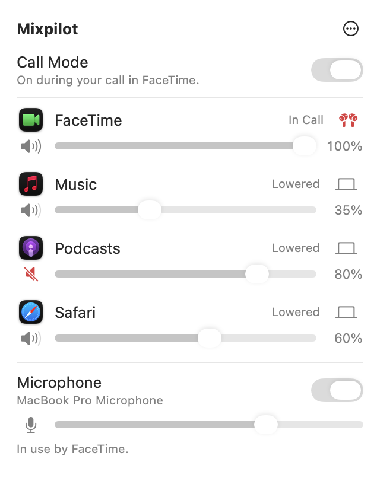

<p align="center">
  
</p>

<h1 align="center">Mixpilot</h1>

<p align="center">
  The volume of every app on your Mac, one by one, and calls that come first.<br>
  Free · macOS 14.4 or later · English and German
</p>

<p align="center">
  <a href="https://mixpilot.blitzraum.com"><b>Website and download</b></a> ·
  <a href="README.de.md">Deutsch</a>
</p>

<p align="center">
  <picture>
    <source media="(prefers-color-scheme: dark)" srcset="docs/images/panel-dark.png">
    
  </picture>
</p>

## What it does

- **Volume for each app.** Turn any app down or mute it from the menu bar, like the volume mixer on
  Windows, but made the way Apple makes Mac apps.
- **Any output for any app.** Send a call to your AirPods while music keeps playing on the speakers.
  When a device disconnects, the app follows the system, and goes back when it reconnects.
- **Calls come first.** When WhatsApp, FaceTime, Zoom, Teams, Webex, Discord or a browser tab uses the
  microphone, every other app fades down to a level you choose, and back up after the call.
  Your own volumes never change.
- **Your microphone at a glance.** See which apps use it, set its input volume, and turn it off for
  all apps at once. The menu bar shows when it is off.
- **Remembers each app.** Settings come back the next time an app plays sound.
- **Keyboard shortcuts** for the microphone, call mode and the app in front.
- **Never louder than the app itself.** Mixpilot only makes apps quieter, to protect your hearing and
  your speakers.

## Install

Download the disk image from [mixpilot.blitzraum.com](https://mixpilot.blitzraum.com), open it and
drag Mixpilot to Applications. It is signed with a Developer ID and notarized by Apple.

The first time, Mixpilot asks for **System Audio Recording**: to change an app's volume, it needs
the sound the app plays. Sound is processed on your Mac and is never saved or sent.

## Privacy and safety

- No accounts, no analytics, no network access.
- If Mixpilot quits or crashes, every app plays normally again: its audio routing is built so that
  a failure never leaves an app silent, and a microphone it turned off is turned back on.
- Settings stay on your Mac (in its preferences).

## Build from source

Requirements: Xcode 27, macOS 14.4 or later to run, a Mac with Apple silicon or Intel.

```bash
git clone https://github.com/ahmedmaaloul/Mixpilot.git
cd Mixpilot
open Mixpilot.xcodeproj
```

Set your own team in `Config/Base.xcconfig` (or leave `DEVELOPMENT_TEAM` empty to sign locally),
then build and run the **Mixpilot** scheme. From the command line:

```bash
scripts/build.sh         # Debug build into build/DerivedData
scripts/run.sh           # build and start
cd MixpilotKit && swift test   # logic and audio kernel tests
```

How it works (Core Audio process taps, the real-time C kernel, call detection) and the project's
conventions are described in [CLAUDE.md](CLAUDE.md).

### Project layout

| Folder | What is in it |
| --- | --- |
| `Mixpilot/` | The app: menu bar panel, Settings, onboarding (SwiftUI) |
| `MixpilotKit/` | Swift package without UI: process and device monitoring, taps, call detection, settings storage, the real-time C kernel, tests |
| `Localization/` | German translations (source of truth) and the script that writes the String Catalogs |
| `Config/` | Bundle ID, signing team, version |
| `scripts/` | Build, run, previews, release |
| `website/` | mixpilot.blitzraum.com |

## Contributing

Bug reports and ideas are welcome as [issues](https://github.com/ahmedmaaloul/Mixpilot/issues).
For code changes, please open an issue first. By contributing, you agree that your contribution is
licensed under the project's license and may also be included in commercial licenses granted by the
author.

## License

Mixpilot is free for personal and other **noncommercial** use under the
[PolyForm Noncommercial License 1.0.0](LICENSE.md). Any commercial use needs written permission:
[support@blitzraum.com](mailto:support@blitzraum.com).

Mixpilot uses [KeyboardShortcuts](https://github.com/sindresorhus/KeyboardShortcuts) by Sindre Sorhus
(MIT License); its notice is in the app's About window.

© 2026 Ahmed Maaloul
